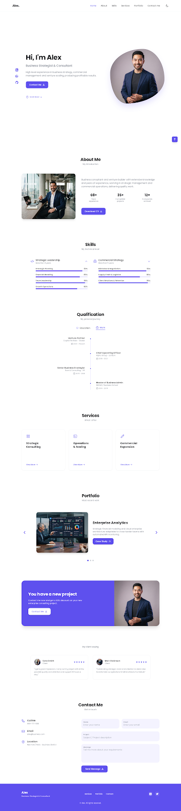

# Alex | Business Strategist & Consultant Portfolio

A modern, high-performance portfolio application built with **React**, **Vite**, and **Tailwind CSS**, featuring dark and light mode toggle support, custom color palette matching, and rich interactive UI components.



---

## ✨ Features

- 🌓 **Dark & Light Theme**: Toggle seamlessly between dark and light modes with instant theme persistence via `localStorage` and system preference auto-detection.
- 🎨 **Modern Design System**: Styled with Tailwind CSS v4 using a signature primary purple palette (`#5E50EE`), organic animated blob avatars, and subtle hover micro-interactions.
- 📱 **Fully Responsive**: Adaptive navigation bar with desktop links and mobile drawer menu.
- 🎓 **Interactive Qualification Timeline**: Switch between **Education** and **Work** experience with a central line timeline layout.
- 📊 **Skills Accordion**: Expandable skill categories featuring animated progress bars.
- 💼 **Service Detail Modals**: Click "View More" on services to inspect detailed offerings in pop-up modal windows.
- 🖼️ **Project Carousel**: Interactive slider featuring recent case studies with navigation arrows and slide indicators.
- 📩 **Contact Form**: Responsive contact form with client-side feedback upon message submission.
- ⬆️ **Scroll to Top**: Floating action button appearing when scrolling down long pages.

---

## 🛠️ Tech Stack

- **Framework**: [React 19](https://react.dev/)
- **Build Tool**: [Vite 8](https://vite.dev/)
- **Styling**: [Tailwind CSS v4](https://tailwindcss.com/)
- **Icons**: [Lucide React](https://lucide.dev/)

---

## 🚀 Getting Started

### Prerequisites

Ensure you have [Node.js](https://nodejs.org/) installed (v18+ recommended).

### Installation

1. **Clone or navigate to the repository**:
   ```bash
   cd portfolio-amine
   ```

2. **Install dependencies**:
   ```bash
   npm install
   ```

3. **Start the development server**:
   ```bash
   npm run dev
   ```
   Open your browser at `http://localhost:5173`.

4. **Build for production**:
   ```bash
   npm run build
   ```

---

## 📁 Project Structure

```text
portfolio-amine/
├── public/
│   ├── code.html          # HTML reference document
│   └── screen.png         # Design reference screenshot
├── src/
│   ├── components/
│   │   ├── Header.jsx         # Navigation bar & theme switcher
│   │   ├── Hero.jsx           # Hero section & social sidebar
│   │   ├── About.jsx          # Intro bio & stats counters
│   │   ├── Skills.jsx         # Accordion skills & progress bars
│   │   ├── Qualification.jsx  # Timeline tabs (Education / Work)
│   │   ├── Services.jsx       # Service cards & detail modals
│   │   ├── Portfolio.jsx      # Multi-project carousel slider
│   │   ├── CalloutBanner.jsx  # Special offer CTA banner
│   │   ├── Testimonials.jsx   # Client feedback & ratings
│   │   ├── Contact.jsx        # Contact info & interactive form
│   │   ├── Footer.jsx         # Footer & quick links
│   │   └── ScrollToTop.jsx    # Floating back-to-top button
│   ├── context/
│   │   └── ThemeContext.jsx   # Dark/Light mode theme provider
│   ├── App.jsx                # Main application assembly
│   ├── index.css              # Global styles & Tailwind configuration
│   └── main.jsx               # Application entry point
├── vite.config.js             # Vite configuration with Tailwind plugin
└── package.json
```

---

